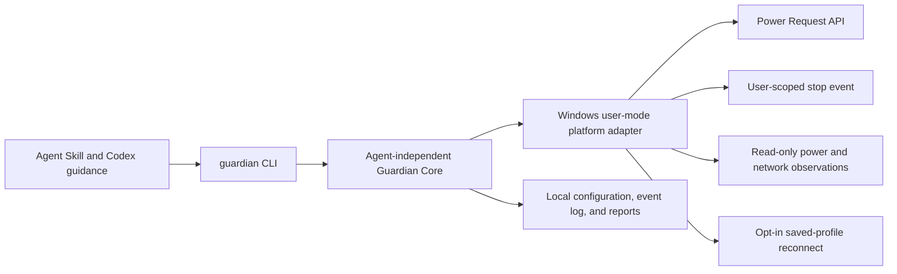

# Architecture

## Product layers

The skill explains how an agent can use Guardian. It is not the runtime and does not install it. The Rust runtime owns power requests independently of an agent model connection. The CLI and skill are thin consumers of an agent-independent core. Local observations and reports stay on the machine; there is no planned telemetry or account requirement.

## Initial runtime boundary

Run as a per-user Windows process, either in the foreground or detached from its invoking terminal. It may hold a narrowly scoped `PowerRequestSystemRequired` request while a bounded lease is valid. It must not request `PowerRequestDisplayRequired`, so Windows can turn off the display and apply its normal lock policy. It must not use Away Mode, synthesize input, edit power plans, or override explicit sleep/shutdown actions.

The runtime binds a lease to an opened process handle and process creation identity, not a PID by itself. Leases are volatile. When the target exits, the lease expires, the user requests `guardian stop`, or the runtime exits, the request is cleared and the OS closes its handle. A protected manual-reset Windows event in the current session carries only the stop signal; its DACL grants only the current user's event-control, wait, and security-query rights. Before using a named event, Guardian verifies its owner and exact protected DACL and fails closed if they do not match. The event accepts no command payload. `guardian stop` can signal active power leases and their associated monitors in the user session; its output confirms the signal was sent, not that every process has finished exiting. No lease is restored after a restart.

Network monitoring begins as observation and classification. Detection produces evidence; a separate pure recovery policy decides whether an operation is safe. The explicit `guardian network --reconnect-saved-wifi` command can submit one request through the first existing Windows profile in preference order. It requires a confirmed Wi-Fi disconnect, confirmed absence of an active default route, and exactly one disconnected wireless interface, then waits up to 20 seconds for association. The same action can run from the monitor only when `--auto-reconnect-saved-wifi` is explicitly enabled; it requires a 10-second sustained local failure, caps consecutive evaluations at three with backoff, and never restarts an adapter. Neither path reads key material, exposes the profile name, or confirms Internet access. Two controlled live tests on 2026-10-22 confirmed Guardian monitor recovery before fallback; broader hardware and network coverage still needs testing.

The default `guardian network` command makes one explicit, read-only `GetAdaptersAddresses` call. It summarizes Wi-Fi adapter presence/operational state, gateway-address presence, and whether a tunnel-type interface is reported. The tunnel signal is only a hint and does not confirm VPN state. The command omits adapter names, SSIDs, and address values, and sends no probes by default. `guardian monitor` registers `NotifyIpInterfaceChange` and `NotifyRouteChange2` notifications and refreshes the local aggregate snapshot on change. It can run for up to 24 hours (60 minutes by default) and falls back to a local snapshot every five minutes. Default monitor mode sends no probes, makes no network or power changes, and does not write network events. With explicit recovery opt-in, it logs only typed reconnect outcomes to a bounded sidecar journal. Reports associate such outcomes with a session by timestamp interval, not by causal session ID.

The runtime installer is a separate, explicit per-user operation. It copies only the currently running executable to `%LOCALAPPDATA%\Programs\AgentGuardian\guardian.exe`, hashing the source and rechecking the staged copy. A caller-supplied SHA-256 can also be checked against a trusted source. Self-hashing does not authenticate a publisher; public release artifacts and trusted checksum distribution are still pending. Installation does not elevate, modify PATH or startup, or remove configuration/logs.

The explicit `guardian network --probe` option resolves two fixed DNS names through the Windows DNS namespace, inspects active default-route metadata, may send one bounded gateway ICMP echo per address family, and makes two fixed one-shot web requests through Windows automatic proxy settings: the Microsoft NCSI HTTP probe and a Cloudflare HTTPS check. WinHTTP redirects, server/proxy authentication, and cookies are disabled, and WinHTTP is configured with 2-second per-stage timeouts. An explicit HTTP 407 response is classified as `PROXY_RESTRICTED`; other proxy transport failures remain ambiguous. TCP retries or proxy discovery can extend total time. Probe outcomes are displayed only and are not journaled. The deterministic classifier requires positive DNS, active route, gateway response, and both independent web checks before reporting `HEALTHY`. The monitor and probes do not confirm VPN state or a user-configured remote service. The current power lease checks source transitions every ten seconds while waiting for its target process; a battery opt-in caps the lease at five minutes from the observed transition, subject to the original TTL.

The saved Wi-Fi recovery implementation uses the Native Wi-Fi API. It reads the preferred profile list, uses only the first profile name in memory, submits a single `WlanConnect` request, and checks interface association state for up to 20 seconds. It does not call `WlanGetProfile`, export credentials, or use shell commands. See the [recovery command and test limits](../development/network-recovery.md).

## Decisions

### ADR-001: Keep the first runtime in the interactive user session

- **Status:** Accepted for the first implementation slice.
- **Context:** A service introduces SYSTEM/admin deployment, session-0 behavior, service permissions, IPC, upgrade, and uninstall attack surfaces before we have shown that a user-mode process cannot meet the Win+L requirement.
- **Decision:** Implement and measure a foreground user-mode process first. Add a narrowly scoped helper only if actual compatibility tests establish that it is necessary.
- **Consequences:** No privileged service or named pipe is required for the first slice. A narrow same-user, same-session stop event is the only runtime IPC. Session behavior remains an explicit hardware/OS test gate; no locked-session support claim is made until tested.

### ADR-002: Hold only the system-required power request

- **Status:** Accepted.
- **Context:** The product must let the display turn off and preserve normal screen-lock behavior while preventing idle sleep when Windows honors the request.
- **Decision:** Use `PowerCreateRequest` and a scoped `PowerSetRequest(PowerRequestSystemRequired)`; do not request DisplayRequired or AwayMode. Pair this with status/doctor diagnostics and explicit release.
- **Consequences:** The display is not intentionally kept awake. Windows policy, user-initiated sleep, battery behavior, and hardware can limit the request; the CLI must report these limitations honestly.

### ADR-003: Separate connectivity classification from recovery

- **Status:** Accepted.
- **Context:** External service outages, DNS problems, VPN changes, captive portals, and local Wi-Fi failures can look similar when relying on one probe.
- **Decision:** Collect bounded evidence, classify conservatively, and pass a typed state to a side-effect-free recovery decision function. Unknown or remote-only failures never justify adapter reset.
- **Consequences:** Local observation and policy are testable without touching a live adapter. The separate saved-profile reconnect is opt-in and is covered by deterministic mock-backend tests; live recovery remains a gated hardware test.

### ADR-004: Keep saved-profile reconnection explicitly authorized and bounded

- **Status:** Accepted.
- **Context:** Automatically reconnecting can override user intent or disturb another healthy route. A profile name is also local network metadata that should not enter logs or output. Windows Native Wi-Fi notifications include profile-name, SSID, and profile-XML fields; the documented reason field describes operation failures and does not provide a reliable intentional-disconnect signal for ordinary disconnected notifications.
- **Decision:** Provide a separate `--reconnect-saved-wifi` command option, refuse unless local evidence confirms a disconnected Wi-Fi interface and no active route, require exactly one disconnected Native Wi-Fi interface, and try one saved profile. Automatic mode is a separate explicit opt-in: wait for a 10-second local Wi-Fi loss with no route, use only the last connected saved profile kept in memory, cap attempts at three with backoff, and allow only one automatic monitor per user session. Do not reset adapters. Keep the profile name only in memory.
- **Consequences:** This creates testable native connection requests without broad network mutation. It does not establish Internet access. Two controlled live tests on 2026-10-22 showed Guardian initiating recovery and confirming association before fallback; broader hardware coverage remains incomplete. The notification payload privacy and ambiguous disconnect cause are documented in the [recovery guide](../development/network-recovery.md).

### ADR-005: Validate the user-scoped stop event before use

- **Status:** Accepted.
- **Context:** `guardian stop` needs to reach active foreground leases without a service, command channel, or global object accessible to other accounts. A named Windows object can already exist when Guardian attempts to create it, so the creation security descriptor alone cannot establish who owns an existing event.
- **Decision:** Use a `Local` manual-reset event named with the session ID and a truncated hash of the current user's SID. Grant only event modification, wait, and security-query rights to that SID. Before waiting or signaling, verify the owner and exact protected DACL; reject objects that differ.
- **Consequences:** The event carries no payload, and `guardian stop` only confirms the request was sent. A different account can still deny startup by pre-creating the predictable name with an ACL that blocks Guardian; it cannot hijack an active lease. Separate-account behavior remains untested.

## Power behavior evidence

Microsoft documents `PowerRequestSystemRequired` as preventing automatic idle sleep, while `PowerRequestDisplayRequired` prevents the session display from turning off and should not be used for this product's display-off mode. `PowerCreateRequest` returns a handle that must be closed; request counts should be cleared before closing. `powercfg /requests` and `/a` are useful diagnostics, but they do not replace real idle and locked-session tests. On 2026-10-22, one 17-minute AC idle-window test with a 20-minute lease and a dummy target recorded no Kernel-Power sleep event and a 36 ms wall/unbiased-clock gap. After release, the system slept on the normal 15-minute idle timer and woke via Power Button; display-off was not directly measured.

Modern Standby changes the guarantee: system-required requests can delay low-power entry indefinitely on AC, but on DC the power-request window is bounded to five minutes in the documented Modern Standby case. User-initiated sleep transitions terminate ordinary requests. Guardian must not promise unconditional uninterrupted work.

PowerRequestExecutionRequired addresses process-lifetime management on supported application platforms; it is not the request used to prevent system idle sleep. SetThreadExecutionState can signal system-required activity too, but its non-continuous form resets the idle timer and must be called periodically. The current design prefers a named Power Request object with an explicit reason and a scoped handle rather than periodic timer resets. Neither API overrides explicit user sleep.

The documented locked-session behavior for display-required requests is not proof that this application's system-required request preserves every locked-session workflow. Win+L, display timeout, idle sleep, and process lifetime must be checked on real supported hardware.

## References

- [PowerCreateRequest](https://learn.microsoft.com/en-us/windows/win32/api/winbase/nf-winbase-powercreaterequest)
- [PowerSetRequest](https://learn.microsoft.com/en-us/windows/win32/api/winbase/nf-winbase-powersetrequest)
- [PowerClearRequest](https://learn.microsoft.com/en-us/windows/win32/api/winbase/nf-winbase-powerclearrequest)
- [Power request types](https://learn.microsoft.com/en-us/windows-hardware/drivers/ddi/wdm/ne-wdm-_power_request_type)
- [SetThreadExecutionState](https://learn.microsoft.com/en-us/windows/win32/api/winbase/nf-winbase-setthreadexecutionstate)
- [Modern Standby preparation](https://learn.microsoft.com/en-us/windows-hardware/design/device-experiences/prepare-software-for-modern-standby)
- [Powercfg command-line options](https://learn.microsoft.com/en-us/windows-hardware/design/device-experiences/powercfg-command-line-options)
- [GetAdaptersAddresses](https://learn.microsoft.com/en-us/windows/win32/api/iphlpapi/nf-iphlpapi-getadaptersaddresses)
- [Power setting GUIDs](https://learn.microsoft.com/en-us/windows/win32/power/power-setting-guids)
- [Agent Skills specification](https://agentskills.io/specification)
- [Vercel Skills CLI](https://github.com/vercel-labs/skills)
