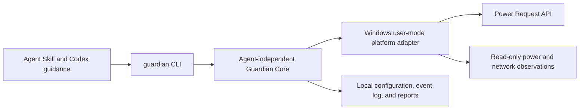

# Architecture

## Product layers

The skill explains how an agent can use Guardian. It is not the runtime and does not install it. The Rust runtime owns power requests independently of an agent model connection. The CLI and skill are thin consumers of an agent-independent core. Local observations and reports stay on the machine; there is no planned telemetry or account requirement.

## Initial runtime boundary

Start with a foreground, per-user Windows process. It may hold a narrowly scoped `PowerRequestSystemRequired` request while a bounded lease is valid. It must not request `PowerRequestDisplayRequired`, so Windows can turn off the display and apply its normal lock policy. It must not use Away Mode, synthesize input, edit power plans, or override explicit sleep/shutdown actions.

The runtime should bind a lease to an opened process handle and process creation identity, not trust a PID by itself. Leases are volatile initially. When the process exits, the lease expires, or the runtime exits, the request is cleared and the OS closes its handle. No lease is restored after a restart in the initial design.

Network monitoring should begin as observation and classification. Detection produces evidence; a separate pure recovery policy decides whether an operation is safe. Initial releases should not restart adapters automatically. Profile reconnection or adapter recovery needs Windows-specific validation, bounded retries, an explicit authorization model, and controlled testing.

The current `guardian network` command makes one explicit, read-only `GetAdaptersAddresses` call. It summarizes Wi-Fi adapter presence/operational state, gateway-address presence, and whether a tunnel-type interface is reported. The tunnel signal is only a hint and does not confirm VPN state. The command omits adapter names, SSIDs, and address values, and sends no network probes. It cannot establish internet, DNS, VPN, captive portal, upstream, or remote-service health. The current power lease checks source transitions every ten seconds while waiting for its target process; a battery opt-in caps the lease at five minutes from the observed transition, subject to the original TTL.

## Decisions

### ADR-001: Keep the first runtime in the interactive user session

- **Status:** Accepted for the first implementation slice.
- **Context:** A service introduces SYSTEM/admin deployment, session-0 behavior, service permissions, IPC, upgrade, and uninstall attack surfaces before we have shown that a user-mode process cannot meet the Win+L requirement.
- **Decision:** Implement and measure a foreground user-mode process first. Add a narrowly scoped helper only if actual compatibility tests establish that it is necessary.
- **Consequences:** No privileged service installation or IPC is required for the first slice. Session behavior remains an explicit hardware/OS test gate; no locked-session support claim is made until tested.

### ADR-002: Hold only the system-required power request

- **Status:** Accepted.
- **Context:** The product must let the display turn off and preserve normal screen-lock behavior while preventing idle sleep when Windows honors the request.
- **Decision:** Use `PowerCreateRequest` and a scoped `PowerSetRequest(PowerRequestSystemRequired)`; do not request DisplayRequired or AwayMode. Pair this with status/doctor diagnostics and explicit release.
- **Consequences:** The display is not intentionally kept awake. Windows policy, user-initiated sleep, battery behavior, and hardware can limit the request; the CLI must report these limitations honestly.

### ADR-003: Separate connectivity classification from recovery

- **Status:** Accepted.
- **Context:** External service outages, DNS problems, VPN changes, captive portals, and local Wi-Fi failures can look similar when relying on one probe.
- **Decision:** Collect bounded evidence, classify conservatively, and pass a typed state to a side-effect-free recovery decision function. Unknown or remote-only failures never justify adapter reset.
- **Consequences:** Initial network support can be useful and testable without touching a live adapter. Real recovery is a later gated feature.

## Power behavior evidence

Microsoft documents `PowerRequestSystemRequired` as preventing automatic idle sleep, while `PowerRequestDisplayRequired` prevents the session display from turning off and should not be used for this product's display-off mode. `PowerCreateRequest` returns a handle that must be closed; request counts should be cleared before closing. `powercfg /requests` and `/a` are useful diagnostics, but they do not replace real idle and locked-session tests.

Modern Standby changes the guarantee: system-required requests can delay low-power entry indefinitely on AC, but on DC the power-request window is bounded to five minutes in the documented Modern Standby case. User-initiated sleep transitions terminate ordinary requests. Guardian must not promise unconditional uninterrupted work.

PowerRequestExecutionRequired addresses process-lifetime management on supported application platforms; it is not the request used to prevent system idle sleep. SetThreadExecutionState can signal system-required activity too, but its non-continuous form resets the idle timer and must be called periodically. The current design prefers a named Power Request object with an explicit reason and a scoped handle rather than periodic timer resets. Neither API overrides explicit user sleep.

The documented locked-session behavior for display-required requests is not proof that this application's system-required request preserves every locked-session workflow. Win+L, display timeout, idle sleep, and process lifetime must be checked on real supported hardware.

## References

- [PowerCreateRequest](https://learn.microsoft.com/en-us/windows/win32/api/winbase/nf-winbase-powercreaterequest)
- [PowerSetRequest](https://learn.microsoft.com/en-us/windows/win32/api/winbase/nf-winbase-powersetrequest)
- [PowerClearRequest](https://learn.microsoft.com/en-us/windows/win32/api/winbase/nf-winbase-powerclearrequest)
- [Power request types](https://learn.microsoft.com/en-us/windows-hardware/drivers/ddi/wdm/ne-wdm-_power_request_type)
- [SetThreadExecutionState](https://learn.microsoft.com/en-us/windows/win32/api/winbase/nf-winbase-setthreadexecutionstate)
- [Modern Standby preparation](https://learn.microsoft.com/en-us/windows-hardware/design/device-experiences/prepare-software-for-modern-standby)
- [Powercfg command-line options](https://learn.microsoft.com/en-us/windows-hardware/design/device-experiences/powercfg-command-line-options)
- [GetAdaptersAddresses](https://learn.microsoft.com/en-us/windows/win32/api/iphlpapi/nf-iphlpapi-getadaptersaddresses)
- [Power setting GUIDs](https://learn.microsoft.com/en-us/windows/win32/power/power-setting-guids)
- [Agent Skills specification](https://agentskills.io/specification)
- [Vercel Skills CLI](https://github.com/vercel-labs/skills)
